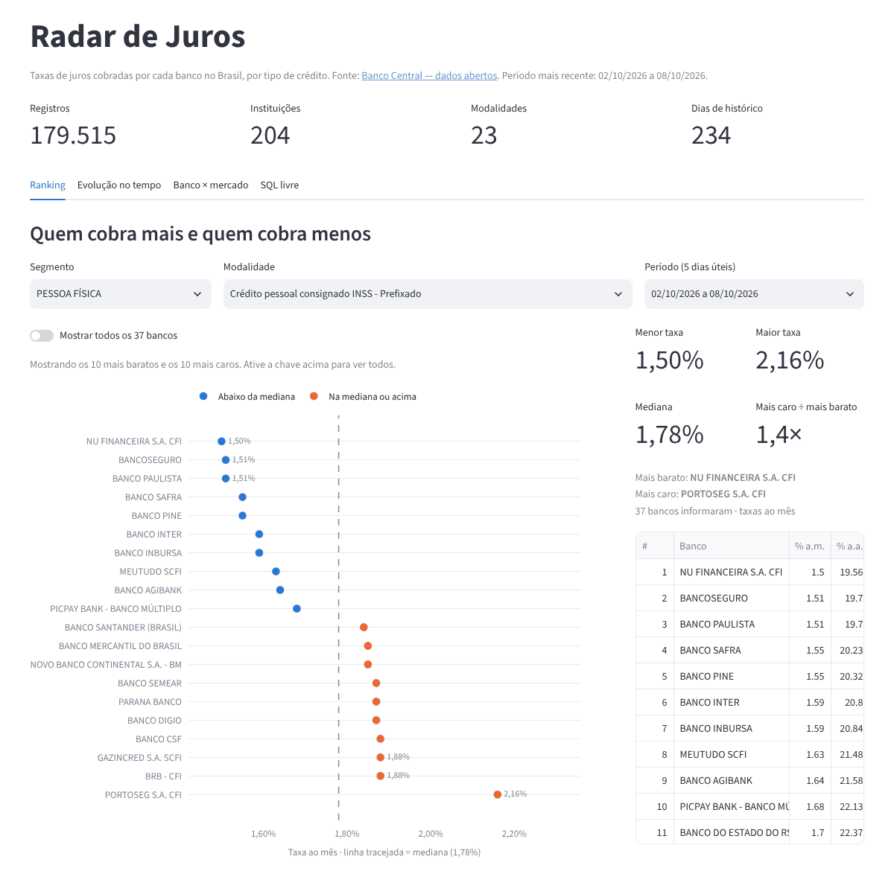
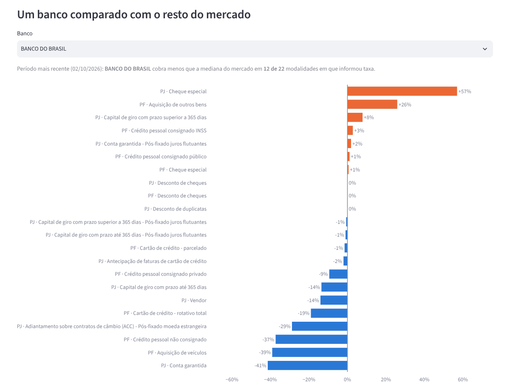
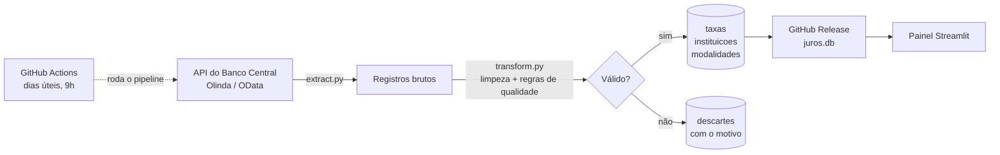
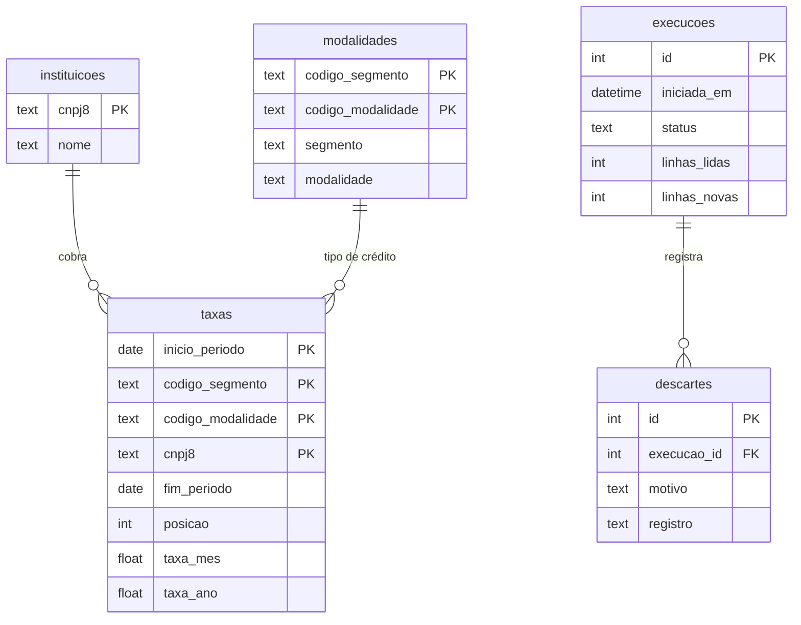

# Radar de Juros

[](https://github.com/joaovictor-rl/radar-juros/actions/workflows/atualizar-dados.yml)
[](https://radar-juros.streamlit.app)

Pipeline de dados que coleta todo dia útil as taxas de juros que **cada banco** cobra no Brasil, direto da API de dados abertos do Banco Central, valida e guarda o histórico num banco relacional — com um painel público para comparar bancos e modalidades e escrever consultas SQL.

### 👉 [Abrir o painel: radar-juros.streamlit.app](https://radar-juros.streamlit.app)



## O que dá para descobrir

Alguns exemplos com os dados de 02/10 a 08/10/2026:

- No **consignado INSS**, 37 instituições informaram taxa: a mais barata cobrava **1,50% ao mês** e a mais cara **2,16%** (mediana de 1,78%).
- No **rotativo do cartão**, a mediana entre 64 instituições era **15,71% ao mês** — quase **9 vezes** a do consignado.
- O **Banco do Brasil** cobrava menos que a mediana do mercado em 12 das 22 modalidades em que informou taxa: 41% abaixo na conta garantida, mas 57% acima no cheque especial para empresas.



O painel tem quatro visões:

| Aba | Para quê |
|---|---|
| **Ranking** | Do banco mais barato ao mais caro numa modalidade e período. |
| **Evolução no tempo** | Até 5 bancos ao longo do ano, contra a mediana do mercado. |
| **Banco × mercado** | Quanto um banco cobra acima ou abaixo da mediana em cada modalidade. |
| **SQL livre** | Consultas próprias sobre o banco (somente leitura), com exportação em CSV. |

## Como funciona



1. **Extração** — busca as taxas diárias na API paginando de 10 mil em 10 mil registros. Na primeira execução traz 1 ano; depois, só os dias que ainda não estão no banco (**carga incremental**).
2. **Transformação** — padroniza tipos e textos, completa o CNPJ com zeros e aplica as regras de qualidade. Cada linha reprovada vai para a tabela `descartes` com o motivo, para auditoria.
3. **Carga** — grava em SQLite (padrão) ou PostgreSQL. Usa `INSERT ... ON CONFLICT`, então rodar duas vezes não duplica nada (**idempotente**). Cada execução fica registrada na tabela `execucoes`.
4. **Automação** — o GitHub Actions roda os testes e o pipeline todo dia útil e publica o `juros.db` atualizado numa release, de onde o painel baixa a base.

### Regras de qualidade

Uma linha é descartada na primeira regra em que falhar:

1. Campo obrigatório vazio
2. Período inválido (fim antes do início)
3. Taxa negativa
4. Taxa zerada (0,00% ao mês — dado não informado pelo banco; foram 321 linhas no último ano)
5. CNPJ inválido
6. Registro duplicado

### Problemas reais que o pipeline resolve

- **Filtro rejeitado pela API:** a biblioteca `requests` codifica espaços como `+`, e a API do BC responde *400 Bad Request*. A URL é montada com espaços como `%20`.
- **Códigos nulos:** a consulta diária devolve `codigoSegmento` e `codigoModalidade` vazios em todas as linhas. Os códigos são completados cruzando o nome da modalidade com a tabela auxiliar `ParametrosConsulta` da mesma API.
- **SQL público sem risco para os dados:** a aba de SQL abre o banco em modo somente leitura (`mode=ro`), então qualquer `INSERT`, `UPDATE`, `DELETE` ou `DROP` é recusado pelo próprio SQLite.

## Modelo de dados



A descrição de cada coluna está no [dicionário de dados](docs/dicionario_de_dados.md), e há consultas de exemplo em [`sql/consultas.sql`](sql/consultas.sql).

## Como rodar no seu computador

Precisa do **Python 3.10+**.

**Windows** — um comando faz tudo (cria o ambiente virtual, instala as dependências e roda):

```powershell
.\rodar.bat            # baixa/atualiza os dados em juros.db
.\rodar.bat painel     # abre o painel em http://localhost:8501
.\rodar.bat testes     # roda os testes
```

**Linux / macOS:**

```bash
python -m venv .venv && source .venv/bin/activate
pip install -r requirements.txt
python pipeline.py               # opcional: --desde 2026-01-01
streamlit run app.py
pytest
```

Para usar PostgreSQL em vez de SQLite, copie `.env.example` para `.env` e preencha `DATABASE_URL`.

## Estrutura

```
├── pipeline.py              # orquestra extração → transformação → carga
├── src/
│   ├── extract.py           # chamadas à API do Banco Central
│   ├── transform.py         # limpeza e regras de qualidade
│   └── load.py              # modelo das tabelas e carga idempotente
├── app.py                   # painel Streamlit
├── tests/                   # testes das regras de transformação (pytest)
├── sql/consultas.sql        # consultas de exemplo
├── docs/                    # dicionário de dados e imagens
├── .github/workflows/       # atualização diária (GitHub Actions)
└── rodar.bat                # atalho para Windows
```

## Tecnologias

Python · pandas · SQLAlchemy · SQLite / PostgreSQL · Streamlit · Plotly · pytest · GitHub Actions

## Fonte dos dados

[Taxas de juros de operações de crédito](https://dadosabertos.bcb.gov.br/dataset/taxas-de-juros-de-operacoes-de-credito) — Portal de Dados Abertos do Banco Central do Brasil. As taxas são médias informadas pelas próprias instituições para cada janela de 5 dias úteis.

---

Feito por **João Victor R. Lisboa** — estudante de Sistemas de Informação na UFPA · [GitHub](https://github.com/joaovictor-rl)
