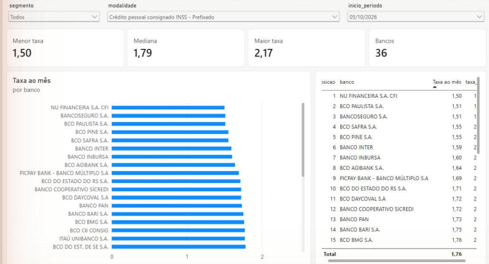
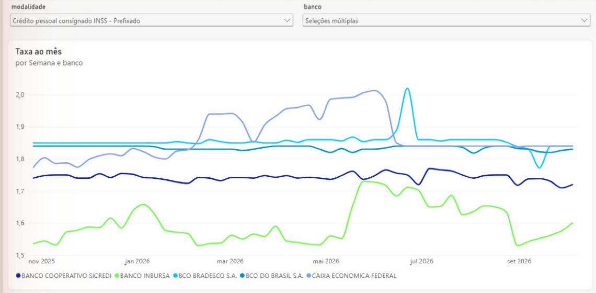

# Radar de Juros

Pipeline em Python que coleta todo dia útil as taxas de juros que cada banco cobra no Brasil, direto da API de dados abertos do Banco Central, valida os dados, guarda o histórico num banco SQLite e gera a base usada num relatório do Power BI.

A pergunta que o projeto responde: **quanto cada banco cobra em cada tipo de crédito, e como isso muda com o tempo?**

## Relatório

**Ranking:** do banco mais barato ao mais caro numa modalidade e período.



**Evolução:** a taxa de cada banco semana a semana.



O relatório está em [`Radar de Juros.pbix`](Radar%20de%20Juros.pbix) (abre no Power BI Desktop, que é gratuito).

## Como funciona

```
API do Banco Central → extract.py → transform.py → load.py → taxas.db + taxas.csv → Power BI
```

1. **Extração** (`src/extract.py`): busca as taxas na API, de 10 mil em 10 mil registros. Na primeira execução traz o último ano; nas seguintes, só os dias que ainda não estão no banco (carga incremental).
2. **Transformação** (`src/transform.py`): padroniza os dados e aplica as regras de qualidade. Linhas que falham são descartadas, e o motivo aparece no resumo da execução.
3. **Carga** (`src/load.py`): grava no SQLite com `INSERT OR IGNORE`, então rodar o pipeline duas vezes não duplica nada. No final, gera o `taxas.csv` para o Power BI.
4. **Automação** (`.github/workflows/atualizar-dados.yml`): o GitHub Actions roda os testes e o pipeline todo dia útil e publica o `taxas.db` e o `taxas.csv` atualizados na [release `dados`](https://github.com/joaovictor-rl/radar-juros/releases/tag/dados).

### Regras de qualidade

Campo obrigatório vazio, período inválido, taxa negativa, taxa zerada (0,00% ao mês é dado não informado pelo banco), CNPJ inválido e registro duplicado. Detalhes no [dicionário de dados](docs/dicionario_de_dados.md).

### Modelo de dados

Duas tabelas: `instituicoes` (CNPJ e nome do banco) e `taxas` (uma linha por período, segmento, modalidade e banco), ligadas pelo CNPJ. O nome do banco fica numa tabela separada porque pode mudar com o tempo. Consultas de exemplo em [`sql/consultas.sql`](sql/consultas.sql).

## Como rodar

Precisa do Python 3.10 ou mais recente.

**Windows:**

```powershell
.\rodar.bat            # baixa ou atualiza os dados
.\rodar.bat testes     # roda os testes
```

**Linux / macOS:**

```bash
python -m venv .venv && source .venv/bin/activate
pip install -r requirements.txt
python pipeline.py     # opcional: --desde 2026-01-01
pytest
```

## Tecnologias

Python (pandas, requests), SQLite, pytest, GitHub Actions e Power BI.

## Fonte

[Taxas de juros de operações de crédito](https://dadosabertos.bcb.gov.br/dataset/taxas-de-juros-de-operacoes-de-credito), Portal de Dados Abertos do Banco Central do Brasil.
